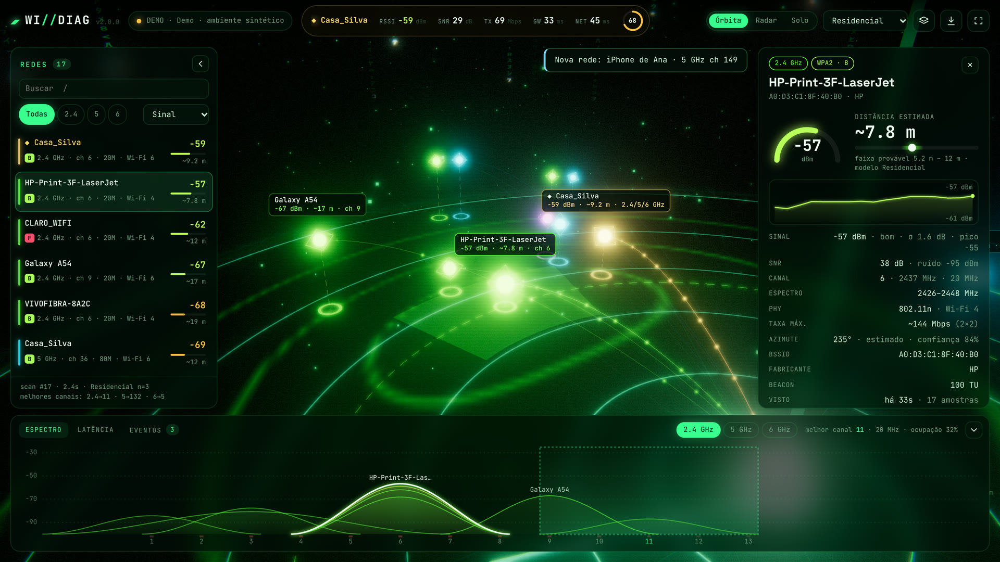
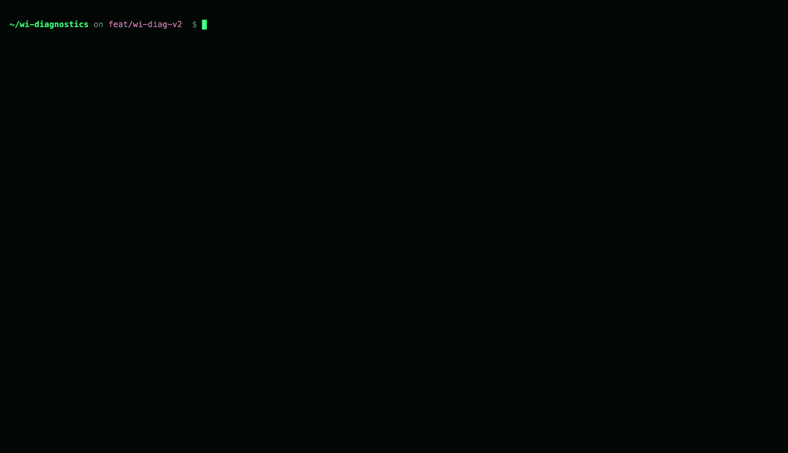
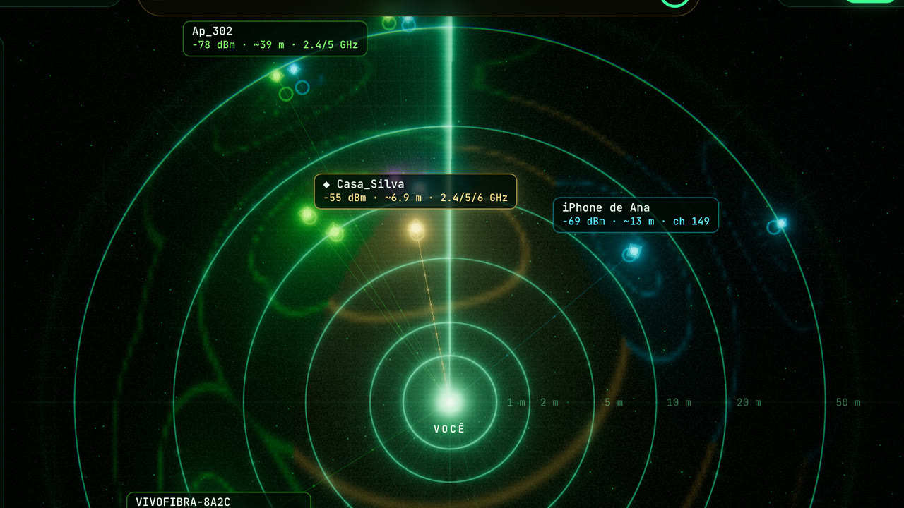
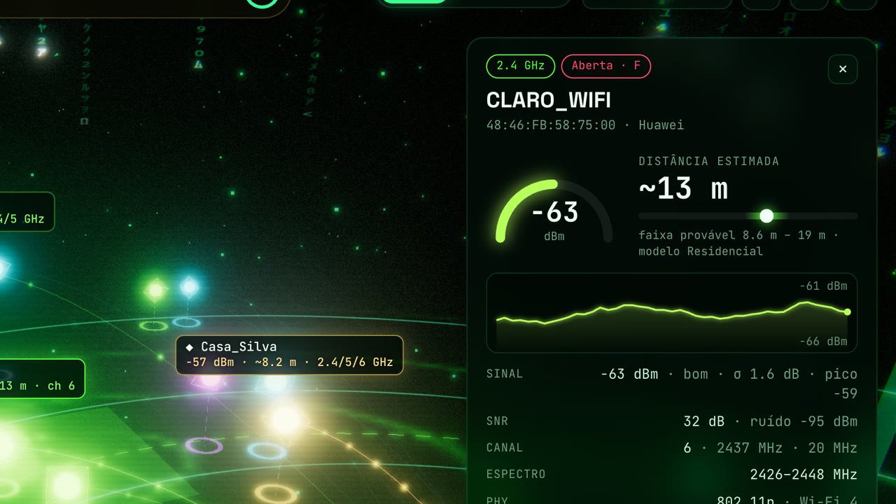
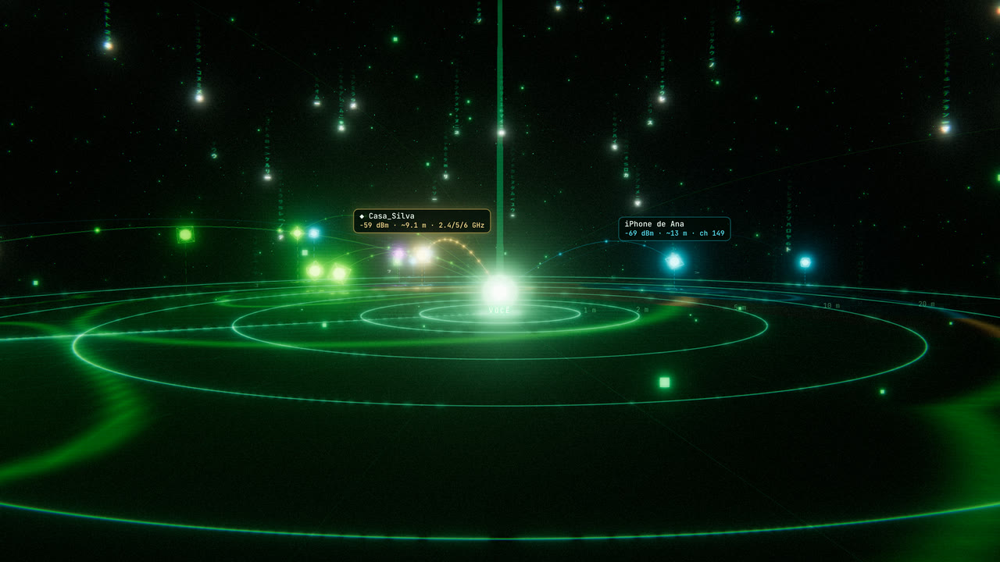
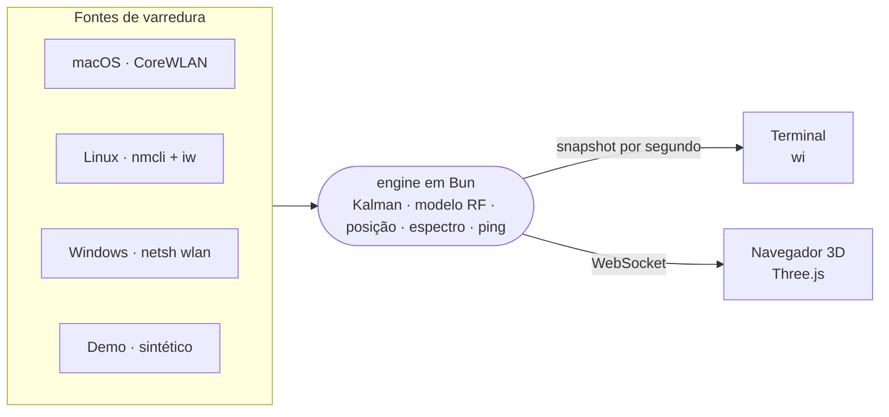

<div align="center">

<p></p>

<p>
  
  
  
  
  <a href="LICENSE"></a>
</p>

<br>

**WI//DIAG** mostra o Wi-Fi que te cerca. Cada rede vira um ponto no radar, na distância estimada pelo sinal,<br>
com o canal que ocupa, quem interfere em quem, a nota de segurança e o canal que você deveria usar.<br>
Tudo ao vivo, em duas interfaces sobre o mesmo engine em Bun.

[Começar](#começar) · [O que ele mostra](#o-que-ele-mostra) · [Atalhos](#atalhos) · [Como funciona](#como-funciona) · [Plataformas](#plataformas) · [Privacidade](#privacidade)

</div>

<br>

<p align="center">
  
  <br>
  <sub><code>npm run web</code>: o espaço RF ao redor do computador. O inspetor está aberto na impressora que divide o canal 6 com o seu roteador.</sub>
</p>

<p align="center">
  
  <br>
  <sub><code>npm run cli</code>: o mesmo engine no terminal. Radar de varredura, link, redes, espectro e eventos em tela cheia.</sub>
</p>

<br>

## O que ele mostra

<table>
  <tr>
    <td width="33%"></td>
    <td width="33%"></td>
    <td width="33%"></td>
  </tr>
  <tr>
    <td valign="top"><b>Campo RF</b><br><sub>A cobertura prevista de cada rede desenhada no piso, com curvas de −50 a −80 dBm. Tecla <code>F</code>.</sub></td>
    <td valign="top"><b>Inspetor</b><br><sub>Distância provável com faixa de incerteza, nota de segurança de A a F, fabricante, canal e histórico do sinal.</sub></td>
    <td valign="top"><b>Modo cinema</b><br><sub>Só o espaço RF, sem painéis, para deixar aberto numa tela. Tecla <code>H</code>.</sub></td>
  </tr>
</table>

| Camada | Dados |
| --- | --- |
| Rádio | RSSI filtrado (Kalman), pico, desvio, ruído e SNR, canal, largura, faixa de espectro ocupada, DFS, PHY, geração Wi-Fi, taxa PHY teórica, intervalo de beacon |
| Segurança | Protocolo (de rede aberta a WPA3/OWE) e nota de A a F |
| Identidade | SSID, BSSID, fabricante (OUI), MAC aleatório, rádios do mesmo AP agrupados |
| Espaço | Distância estimada com faixa de incerteza, azimute provável e altura |
| Espectro | Ocupação por canal, interferência co-canal e parcial, SIR, melhor canal por banda |
| Link | RSSI e SNR ao vivo, taxa TX, MCS, IP/IPv6, gateway, MAC e fabricante do roteador, DNS |
| Rede | Latência, jitter e perda até o gateway e até a internet (1.1.1.1), diagnóstico do link |
| Eventos | Novas redes, redes perdidas, roaming, troca de canal, queda de sinal, picos de latência, internet fora do ar, syslog do roteador |

## Começar

```bash
npm install          # instala o Bun (local), o Three.js e o resto
npm run cli          # painel no terminal
npm run web          # visualização 3D no navegador (http://127.0.0.1:3333)
npm run demo         # painel com um ambiente sintético, sem hardware
```

> [!TIP]
> No macOS, rode `npm run authorize` uma vez e aceite o pedido de Localização. Sem essa permissão o sistema esconde SSID e BSSID.

Com o Bun instalado globalmente, `bun run cli` e `bun run web` também funcionam, e `npm link` deixa o comando `wi` no PATH. `npm run web:demo` abre a visualização 3D com o ambiente sintético.

### App desktop

O GitHub Actions gera o app para macOS (Apple Silicon), Windows e Linux em cada PR e em cada versão, e as versões publicadas ficam em [Releases](https://github.com/Dellacarmo/Wi-diagnostics/releases). Para gerar o instalador do seu sistema, rode `npm run build`.

Os instaladores ainda não têm assinatura de desenvolvedor. No macOS, libere o app em Ajustes do Sistema → Privacidade e Segurança → "Abrir Mesmo Assim". No Windows, clique em "Mais informações" → "Executar mesmo assim".

## Atalhos

<table>
<tr><th>Terminal</th><th>Navegador 3D</th></tr>
<tr><td valign="top">

| Tecla | Ação |
| --- | --- |
| `↑` `↓` ou `j` `k` | seleciona uma rede |
| `PgUp` `PgDn` · `g` `G` | pula 10 · vai ao início ou ao fim |
| `⏎` ou espaço | abre ou fecha os detalhes |
| `f` | filtra por banda |
| `s` | muda a ordenação |
| `b` | banda do espectro |
| `e` | modelo de ambiente |
| `w` | abre a visualização 3D |
| `m` | chuva digital |
| `p` | pausa |
| `q` | sai |

</td><td valign="top">

| Tecla | Ação |
| --- | --- |
| `1` `2` `3` | câmera: órbita, radar, solo |
| `H` | modo cinema |
| `F` | campo RF |
| `R` · `B` · `L` | chuva · feixes · rótulos |
| `N` · `D` | recolhe a lista · o painel de baixo |
| `/` | busca |
| `↑` `↓` | navega entre as redes |
| `⏎` | centraliza a rede escolhida |
| `Esc` | limpa a seleção |
| espaço | auto-rotação |

</td></tr>
</table>

No navegador, clique num nó, numa linha da lista ou numa curva do espectro para abrir o inspetor. O menu de exportação gera PNG da cena, CSV e JSON e, com as dependências Python instaladas, relatórios em PDF, DOCX e XLSX.

## Como funciona



O engine varre o ar a cada 2 s, filtra o RSSI de cada rádio, mantém a identidade das redes entre varreduras (mesmo quando o sistema esconde o BSSID), estima posições, mede o espectro e a latência e publica um snapshot por segundo. O terminal desenha esse snapshot; o servidor HTTP o entrega à cena 3D por WebSocket.

### Como a posição é estimada

Com um único receptor parado, só a **distância** é observável. Ela vem do RSSI pelo modelo log-distância, com referência a 1 m por banda e expoente de perda por ambiente (`--env open|residential|office|dense`, alterável ao vivo com `e`). A faixa mostrada combina o sombreamento típico do ambiente com a variação medida do sinal.

O **azimute** não é observável com uma antena. Ele é inferido assim: rádios do mesmo AP compartilham a direção, redes cujo sinal oscila junto (correlação de Pearson) ficam próximas, e uma semente determinística mantém o layout estável. Por isso a interface mostra o anel de distância e um setor provável, não um ponto exato.

O **campo RF** no piso 3D é a previsão do modelo a partir dessas posições estimadas, com curvas de nível em −50, −60, −70 e −80 dBm. Com uma rede selecionada, ele mostra só a cobertura dela.

## Plataformas

| Sistema | Fonte | Observações |
| --- | --- | --- |
| macOS | Helper Swift/CoreWLAN, compilado no primeiro uso (precisa das Command Line Tools) | Sem permissão de Localização o macOS esconde SSID e BSSID: rode `npm run authorize`. Sem `swiftc`, cai para o `system_profiler`, bem mais limitado. |
| Linux | `nmcli` (NetworkManager) e `iw` para o link | SSID e BSSID completos |
| Windows | `netsh wlan` | Saída em inglês ou português |

Sem nenhuma fonte disponível, o engine entra no modo demo e avisa na interface.

## Privacidade

- Tudo roda na sua máquina. O servidor da visualização 3D escuta só em `127.0.0.1` e recusa origens que não sejam locais.
- O que sai para a rede: o ping até o gateway e até `1.1.1.1`, para medir a latência; a fonte JetBrains Mono, que a interface 3D carrega do Google Fonts; e a base de fabricantes da IEEE, só quando você roda `wi oui update`.
- Com `--syslog`, o engine também escuta UDP na porta 1514 para receber o log do roteador.
- As imagens deste README vêm do modo demo: redes, endereços e BSSIDs são fictícios.

## Linha de comando

```text
wi                      painel ao vivo no terminal
wi web                  visualização 3D no navegador
wi scan [--json]        varredura única (tabela ou JSON)
wi authorize            macOS: libera SSID e BSSID (permissão de Localização)
wi oui update           baixa a base de fabricantes da IEEE

--demo                  ambiente sintético (sem hardware)
--web                   (painel) também sobe a visualização 3D
--port <n>              porta HTTP da web (padrão 3333)
--no-open               não abre o navegador
--env <modelo>          open | residential | office | dense (padrão residential)
--interval <s>          intervalo entre varreduras (padrão 2)
--iface <nome>          interface Wi-Fi (Linux/Windows)
--syslog [porta]        escuta syslog UDP do roteador (padrão 1514)
```

## Estrutura

```text
engine/            núcleo em TypeScript (Bun)
  sources/         macOS (Swift/CoreWLAN), Linux, Windows, demo
  rf.ts            modelo de propagação, canais, Kalman, classificação
  tracker.ts       identidade entre varreduras (inclusive sem BSSID)
  layout.ts        posição provável
  spectrum.ts      ocupação, interferência, melhor canal
  netinfo.ts       IP, gateway, DNS, ping
  engine.ts        orquestração, eventos, snapshots
cli/               comando wi e painel do terminal
server/            servidor HTTP + WebSocket (Bun.serve)
web/               cena 3D (Three.js) e interface
electron/          janela desktop (npm run electron)
python/            CLI Python original e gerador de relatórios
```

### CLI Python original

O backend Python continua disponível (`npm run legacy` ou `python monitor.py`) e serve de ponte para os relatórios em PDF, DOCX e XLSX:

```bash
pip install -r python/requirements.txt
```

## Contribuir

PRs são bem-vindos: veja o [guia de contribuição](CONTRIBUTING.md) e o [código de conduta](CODE_OF_CONDUCT.md). A `main` só recebe código por pull request revisado pelos code owners e com o build passando.

## Licença

[Apache-2.0](LICENSE). Quem usar o código precisa manter os créditos do [NOTICE](NOTICE) e indicar o que mudou. A licença não dá direito ao nome WI//DIAG nem à marca ◢◤.

<br>

<div align="center">
<sub>Bun · TypeScript · Three.js · tipografia JetBrains Mono (OFL)</sub>
</div>
